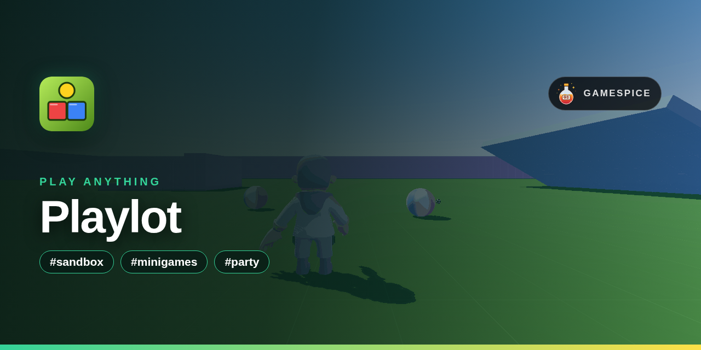
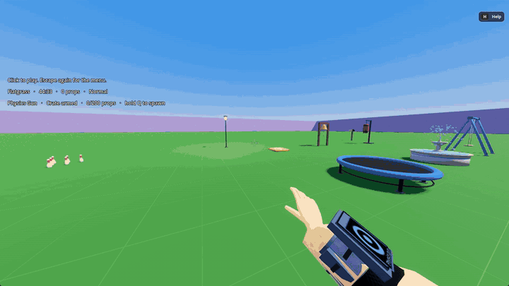
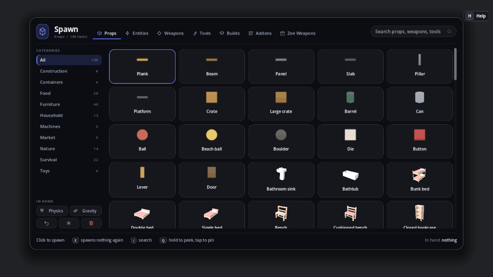
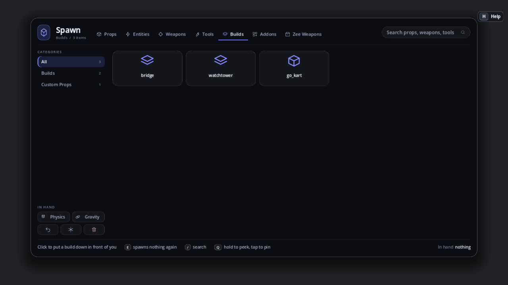
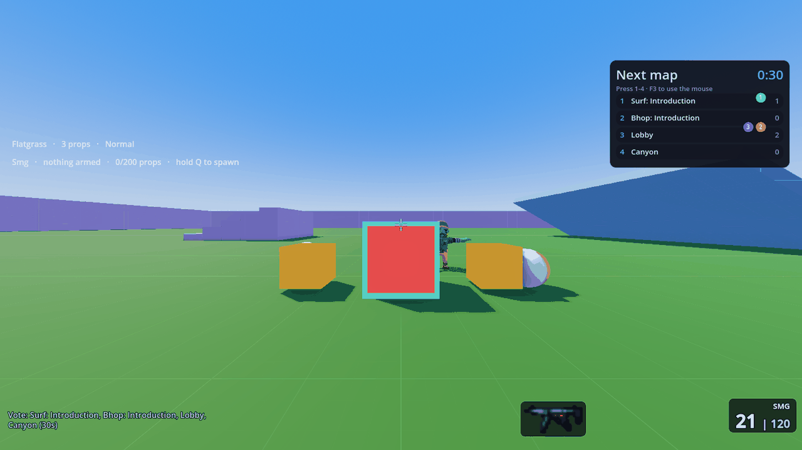
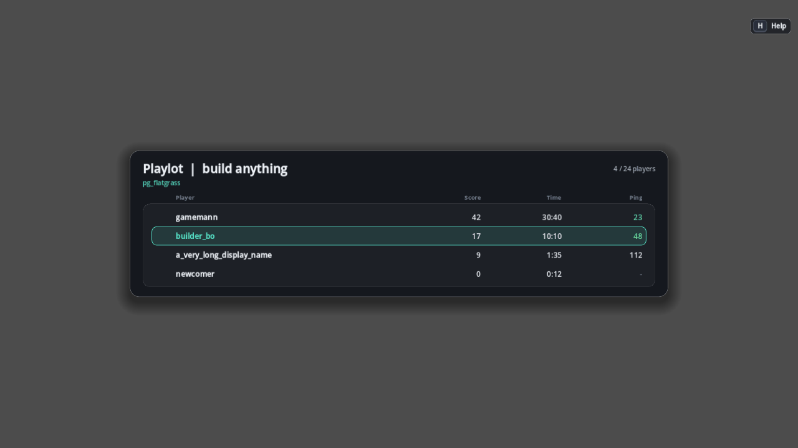
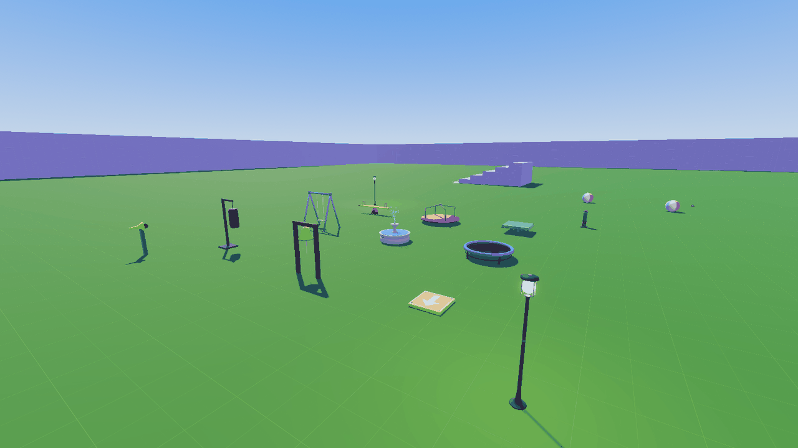
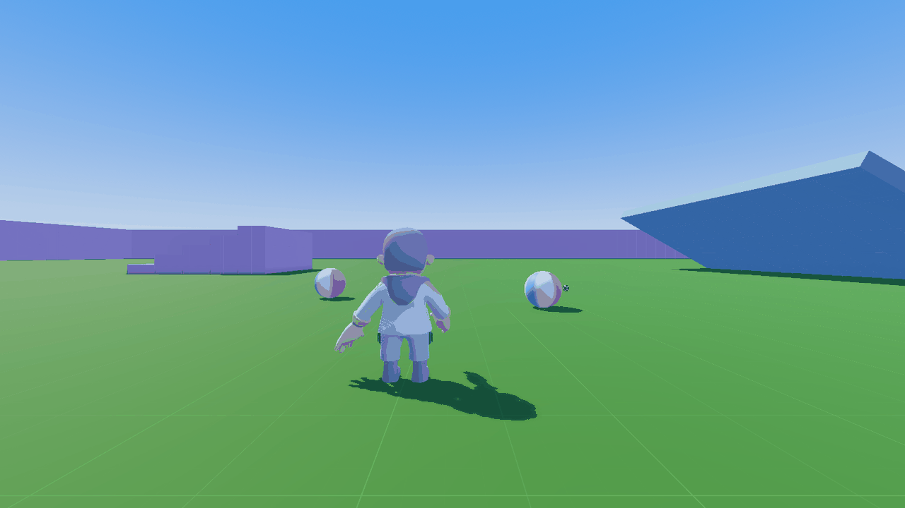

Playlot is a 3D multiplayer sandbox. You can build with props, spawn NPCs and weapons, grab things with the physics and gravity guns, and mess around with other players. It is inspired by classic sandbox games like Garry's Mod.

Hold **Q** in game to open the spawn menu.



[Play on the test server](https://moddingcommunity.com/playlot/s/pg01/play).

It is built on [Godot 4](https://godotengine.org/), the [**GameSpice**](https://gamespice.net) platform and addon collection. Everything in this repository is open source under the MIT license. The only closed part is the website back-end it can sign in through. If you do not want to use GameSpice, you can plug in your own sign-in back-end.

Playlot belongs to Zee's Games, a collection of open source multiplayer games on the GameSpice platform, all running on live servers. It is built and maintained with Claude Code under the MIT license. Found a bug? Open an issue on the [issue tracker](https://github.com/zees-games/game-playlot/issues).

## Screenshots

<table>
<tr>
<td><br>The spawn menu: props, entities, weapons and tools.</td>
<td><br>Saved builds you can put down in front of you.</td>
</tr>
<tr>
<td><br>The map vote ballot in chat.</td>
<td><br>The scoreboard.</td>
</tr>
<tr>
<td><br>Park toys on the flatgrass sandbox map.</td>
<td><br>Third-person view on flatgrass.</td>
</tr>
</table>

## How it plays

Hold **Q** to open the spawn menu. Clicking something spawns it, and the menu stays open so you can keep building. Press `/` to search.

| Tab | What is in it |
| --- | --- |
| Props | Planks, panels, beams and pillars to build with; crates and barrels; balls from a beach ball to a boulder; buttons, levers and doors |
| Entities | NPCs: one wanders, one chases you, one hops, one spins, a hunter, and soldiers and rebels that carry weapons. Soldiers fight players and rebels. Rebels fight soldiers and follow you. |
| Weapons | A launcher that fires props, a remover, an impulse gun, and the 27 weapons of [zee-gs-weapons](https://github.com/zees-games/zee-gs-weapons). Right click a weapon to drop it on the ground. |
| Tools | The tool gun: inflate, colour, remove, weld, no-collide, rope, balloon, physical properties, wire, giving an NPC a weapon, and editing a selected prop |

Things you can do:

- **Pick props up** with the physics gun and freeze them in place, or punt them with the gravity gun. You can pick other players up too (`pg_pickup`).
- **Play with the map's toys.** Every sandbox map has some: balls to kick (**F**) or shoot, a bowling lane, barrels and tyres, swings, see-saws, a roundabout that carries you, trampolines, lamps on a switch, a fountain, a horn and a bell. `sv_toys 0` takes them away.
- **Ride props.** Stand on a moving prop and it carries you.
- **Edit a prop.** Pick the tool gun's *Edit properties* mode and click a prop. The Tools tab shows its size, colour, freeze, gravity, weight, friction and bounce, and the prop changes as you drag. Right click lets go. **R** puts it back as it was spawned.
- **Wire things up.** Use the tool gun's wire mode to connect a button or lever to a door, then press it with **F**.
- **Save what you built** with `pg_save <name>` and load it later with `pg_load <name>`.
- **Break things.** When the server has `pg_destruction 1`, crates and planks break apart and barrels explode.
- **Creative mode.** Type `!creative`. Nobody can touch you or your props, and you cannot hurt anybody.
- **Fight.** `pg_arena 1` turns on damage between players, and `pg_waves` sends waves of armed NPCs. The dead fall as ragdolls (via [gs-player-char](https://github.com/gamespice-platform/player-char)). `sv_ragdoll 0` gives a quick fall with no physics, and `sv_ragdoll_reactions` weights the kinds of fall.

### Maps

| Map | What it is |
| --- | --- |
| `pg_flatgrass` | The default sandbox: a walled 200-metre plate of grass, with a corner of ramps and steps and the map's toys near the spawn |
| `pg_generated` | Built from a seed each time it loads: rooms joined by corridors, with props scattered through them. Start with `--pg-map-seed=<n>` to pick the seed and share a layout. |
| Map pack | More maps come from the Playlot map pack (published as the pack id `gamemann/playlot-maps`, a legacy id) |

## Controls

Every key can be rebound under Controls in the menu.

| Key | Action |
| --- | --- |
| Q | Spawn menu. Hold to browse, tap to pin it open. |
| Mouse 1 | Grab with the physics gun, punt with the gravity gun, fire a weapon |
| Mouse 2 | Freeze what you hold, or pull with the gravity gun; with a gun, aim down the sights |
| Mouse 3 | A gun's quick melee |
| Wheel | Move a held prop nearer or further |
| Shift + mouse | Turn a held prop |
| 1 / 2 / 3 | Physics gun / gravity gun / your weapons |
| E | Spawn the last prop again |
| F | Use: press a button, pull a lever, get in or out of a vehicle |
| O | Throw the gun in your hands |
| T | Flashlight (off by default on the daylit sandbox, on in the rock maps). A lit beam can be seen by anyone who can see you. |
| R | Reload; with no gun, unfreeze everything you froze; the tool gun's third action |
| Z | Undo your last spawn |
| WASD / Space / Ctrl | Move / jump (hold to keep hopping) / crouch |
| F5 | First or third person |
| Tab (hold) | Scoreboard: who is on, score, time connected and ping |
| Y / U | Chat / chat with nearby players |
| M | Change map |
| B | Loadout: the weapon you spawn with when fights are on |
| K | Push to talk |
| J / L | Look at a player and stop hearing them / mute them |
| F6 / F7 / F8 | Admins and staff: NPC and weapon workbench, spawn point editing |
| H | Help: what the game is and every key as you have it bound |
| Esc | Release the mouse; press again for the menu |

## Getting started

You need [Godot 4.7](https://godotengine.org/download). The game uses many GameSpice addons, each in its own repository. The easiest way to get everything is [gs-bootstrap](https://github.com/gamespice-platform/bootstrap), which clones each project and links the addons into it:

```bash
git clone https://github.com/gamespice-platform/bootstrap.git
cd gs-bootstrap
./bootstrap.sh
cd projects/game-playlot
./game.sh
```

On Windows, run `bootstrap.ps1` instead and open the project in Godot.

| Command | What it does |
| --- | --- |
| `./game.sh` | Play offline, in a window |
| `./game.sh online` | Start a local server and the browser client, and print the link to open |
| `./game.sh online down` | Stop them |
| `./game.sh server` | Start a local dedicated server only |
| `./game.sh test` | Check every script and run every test suite |
| `./game.sh shot` | Save a screenshot to `screenshots/` |
| `./game.sh help` | List all options |

`online` and `server` use [gs-server-deploy](https://github.com/gamespice-platform/server-deploy), which bootstrap clones next to this project. Run its `./setup.sh` once first.

## Running a server

Settings are console variables ("cvars"). Set them in the server's config, on the command line, or live from the console. `cvarlist pg_` lists all of them. Every game setting is also a key in a file under `cfg/game/game-playlot/config_<group>/game.yml` (a server refuses to start on an unknown key) and a row in the admin workbench. `!block` and `!noblock` toggle player collision.

| Setting | Default | What it does |
| --- | --- | --- |
| `max_players` | 32 | Player slots (1 or more, no upper limit in the game). Changing it needs a restart. |
| `pg_map_seconds` | 2700 | How long a map runs before the vote (0 = forever) |
| `pg_creative` | 1 | Players may turn on creative mode |
| `pg_prop_surf` | 1 | Moving props carry the players standing on them |
| `pg_destruction` | 0 | Props can break, and barrels explode |
| `pg_pickup` | 1 | The physics gun can pick players up |
| `pg_pickup_immune` | see `cvarlist` | Roles nobody may pick up |
| `pg_pickup_override` | see `cvarlist` | Roles that may pick anybody up |

### Per-player limits

Each player has a limit for each kind of thing. A limit of 0 means no limit. A role (an admin group, or `admin` / `root`) can be given more.

| Setting | Default | Counts |
| --- | --- | --- |
| `pg_max_props` | 200 | Props |
| `pg_max_npcs` | 10 | NPCs |
| `pg_max_entities` | 20 | Other entities |
| `pg_max_vehicles` | 4 | Vehicles |
| `pg_max_balloons` | 30 | Balloons |
| `pg_max_weapons` | 20 | Weapons |
| `pg_max_constraints` | 100 | Welds, ropes and no-collides |

```
pg_max_npcs 10
pg_limit_roles "admin: npcs=40 props=600; vip: props=300 balloons=60"
pg_limits u3                 // what player u3 is using against their limits
```

### Console commands

| Command | What it does |
| --- | --- |
| `pg_status` | What the server is doing |
| `pg_map <id>`, `pg_nextmap`, `pg_rtv` | Change the map, see what is next, rock the vote |
| `pg_arena [0\|1]` | Damage between players on or off |
| `pg_waves` | Waves of armed NPCs |
| `pg_props_clear` | Remove every prop |
| `pg_save <name>`, `pg_load <name>`, `pg_builds`, `pg_build_delete <name>` | Saved builds |
| `pg_shop [0\|1]` | Prices for spawning, paid from a bag |
| `pg_give <player> <prop> [count]`, `pg_inv <player>` | Put things in a player's bag, or read it |

Admin commands such as `!noclip`, `!freeze`, `!slay` and `!bring` come from [gs-moderation](https://github.com/gamespice-platform/moderation). `blind <player>` blacks out that player's screen, and `beacon <player>` puts a ring and a ping on them for everybody to see.

### Fight mode defaults

With fights on, a round lasts 240 seconds or until someone reaches 25 kills. These are server settings (`arena_round_sec`, `arena_score_limit` in the config), as are health, armour, respawn time and friendly fire.

### The map vote

Players vote on the next map with [gs-vote](https://github.com/gamespice-platform/vote). The defaults are in `game/playlot_vote.gd`. To change them, put a file at `user://cfg/playlot_vote.json` (a file at the path under the old Playlot name is copied there once), or use `GS_VOTE_*` environment variables or `--vote-*` arguments:

```json
{ "end_vote": true, "vote_lead_sec": 120, "include_extend": true, "extend_seconds": 900, "max_extends": 4 }
```

`end_vote: false` turns the end-of-map vote off. `include_extend: false` removes "extend" from the ballot. The gs-vote README lists every setting.

### The bag and the shop

With `pg_shop 1`, spawning costs money. A player's bag is a 10 x 6 grid with a 400 kg limit by default. Buying puts things in it, and spawning something you carry is free. There is no screen for the bag yet.

### Run timer

The game does not ship a run timer. A server that wants timed courses adds [gs-timer](https://github.com/gamespice-platform/timer): put its `addons/gs_timer` folder in the project, run `godot --headless --path . --import` once, and start the server. The game's own `addons/pg_timer` notices it and turns on timing: zones from a map's zone file, records, leaderboards and the commands `pg_timer`, `pg_track`, `pg_top`, `pg_cp`, `pg_tp` and `pg_cp_clear`. Details in [docs/timer.md](docs/timer.md).

### Spawn providers

An optional pack can add weapons, NPCs and bots to the Q menu by shipping `addons/<pack>/spawn_provider.gd` with `spawn_entries() -> Array[Dictionary]`. The game finds it at start. With no pack installed nothing changes. See [docs/spawn-providers.md](docs/spawn-providers.md).

## Testing

```bash
./game.sh test                         # every script parses, then every suite runs
./game.sh test headless_playlot     # one suite
```

| Suite | What it covers |
| --- | --- |
| `headless_config`, `headless_workbench`, `headless_mapcfg` | Settings, the workbench and per-map config |
| `headless_mapdrop` | Maps dropped on the window or the executable, a dropped Garry's Mod map as its PLAYLOT conversion (gm_fork is pgc_fork), and the refusal of anything else |
| `headless_mountload` | A maps pack mounted at runtime through gs-cloud (replaced files allowed): its documents are listed and the map loads as a PackedScene |
| `headless_playlot` | The whole game: props, NPCs, weapons, every tool, limits, the menu, map changes, and the run timer when linked |
| `headless_net` | A server and a client in one process, over the network code |
| `headless_presentation` | What a client draws and plays |
| `headless_stack` | All the addons together |
| `headless_packs_real` | The real content packs |
| `headless_weapondrop`, `headless_spawntool`, `headless_solomap` | Dropping weapons, the spawn tool, a single-player map |
| `headless_npc_weapon_idle` | An armed NPC's idle weapon tick (the rig's own, no context or wall probe) against the full one: rig snapshots agree tick for tick |
| `dedicated` | A real server: boots, loads the game, runs its commands |

[`CLAUDE.md`](CLAUDE.md) has the contributor rules and [`docs/`](docs/README.md) the design decisions.

## Built on

The addons in `addons/` come from the GameSpice platform: [gs-achievements](https://github.com/gamespice-platform/achievements), [gs-animation](https://github.com/gamespice-platform/animation), [gs-audio](https://github.com/gamespice-platform/audio), [gs-auth](https://github.com/gamespice-platform/auth), [gs-bot](https://github.com/gamespice-platform/bot), [gs-bot-record](https://github.com/gamespice-platform/bot-record), [gs-browser](https://github.com/gamespice-platform/browser), [gs-camera](https://github.com/gamespice-platform/camera), [gs-chat](https://github.com/gamespice-platform/chat), [gs-cloud](https://github.com/gamespice-platform/cloud), [gs-combat](https://github.com/gamespice-platform/combat), [gs-console](https://github.com/gamespice-platform/console), [gs-core](https://github.com/gamespice-platform/core), [gs-economy](https://github.com/gamespice-platform/economy), [gs-effects](https://github.com/gamespice-platform/effects), [gs-entity](https://github.com/gamespice-platform/entity), [gs-flashlight](https://github.com/gamespice-platform/flashlight), [gs-fx](https://github.com/gamespice-platform/fx), [gs-game](https://github.com/gamespice-platform/game), [gs-input](https://github.com/gamespice-platform/input), [gs-inventory](https://github.com/gamespice-platform/inventory), [gs-leaderboard](https://github.com/gamespice-platform/leaderboard), [gs-lighting](https://github.com/gamespice-platform/lighting), [gs-loadout](https://github.com/gamespice-platform/loadout), [gs-map](https://github.com/gamespice-platform/map), [gs-match](https://github.com/gamespice-platform/match), [gs-menu](https://github.com/gamespice-platform/menu), [gs-mobile](https://github.com/gamespice-platform/mobile), [gs-moderation](https://github.com/gamespice-platform/moderation), [gs-net](https://github.com/gamespice-platform/net), [gs-npc](https://github.com/gamespice-platform/npc), [gs-npc-ai](https://github.com/gamespice-platform/npc-ai), [gs-npc-ai-director](https://github.com/gamespice-platform/npc-ai-director), [gs-peer-to-peer](https://github.com/gamespice-platform/peer-to-peer), [gs-physics](https://github.com/gamespice-platform/physics), [gs-platform](https://github.com/gamespice-platform/platform), [gs-player](https://github.com/gamespice-platform/player), [gs-player-char](https://github.com/gamespice-platform/player-char), [gs-player-class](https://github.com/gamespice-platform/player-class), [gs-player-controller](https://github.com/gamespice-platform/player-controller), [gs-procedural-generation](https://github.com/gamespice-platform/procedural-generation), [gs-profile](https://github.com/gamespice-platform/profile), [gs-profiler](https://github.com/gamespice-platform/profiler), [gs-props](https://github.com/gamespice-platform/props), [gs-save](https://github.com/gamespice-platform/save), [gs-server](https://github.com/gamespice-platform/server), [gs-server-query](https://github.com/gamespice-platform/server-query), [gs-settings](https://github.com/gamespice-platform/settings), [gs-sim](https://github.com/gamespice-platform/sim), [gs-spawn](https://github.com/gamespice-platform/spawn), [gs-spectate](https://github.com/gamespice-platform/spectate), [gs-sql](https://github.com/gamespice-platform/sql), [gs-stats](https://github.com/gamespice-platform/stats), [gs-team](https://github.com/gamespice-platform/team), [gs-ui](https://github.com/gamespice-platform/ui), [gs-user](https://github.com/gamespice-platform/user), [gs-user-avatar](https://github.com/gamespice-platform/user-avatar), [gs-vehicle](https://github.com/gamespice-platform/vehicle), [gs-voice](https://github.com/gamespice-platform/voice), [gs-vote](https://github.com/gamespice-platform/vote), [gs-weapon](https://github.com/gamespice-platform/weapon), [gs-workbench](https://github.com/gamespice-platform/workbench).

Game-specific content packs: [fc-weapons](https://github.com/zees-games/fc-weapons), [natural-disasters](https://github.com/zees-games/natural-disasters), [zee-gs-weapons](https://github.com/zees-games/zee-gs-weapons), [zz-historical-monsters](https://github.com/zees-games/zz-historical-monsters), [zz-medieval-weapons](https://github.com/zees-games/zz-medieval-weapons), [zz-modern-weapons](https://github.com/zees-games/zz-modern-weapons). The SQLite records backend uses the [godot-sqlite](https://github.com/2shady4u/godot-sqlite) extension.

## More from Zee's Games

The other games run on the same GameSpice addons, so they show what the platform can do better than any list of features.

| Game | What it is | Source |
| --- | --- | --- |
| [Fatal Contact](https://zeesgames.com/fatal-contact) | Fast first-person deathmatch with GunGame and classic Surf Deathmatch maps. | [game-fatal-contact](https://github.com/zees-games/game-fatal-contact) |
| [Airdrift](https://zeesgames.com/airdrift) | Bunny hop and surf timer runs with Source-style movement and leaderboards. | [game-airdrift](https://github.com/zees-games/game-airdrift) |
| [Hungario](https://zeesgames.com/hungario) | Steer a hungry monster, eat to grow and outlast everyone else. | [game-hungario](https://github.com/zees-games/game-hungario) |
| [Buses From Hell](https://zeesgames.com/buses-from-hell) | Survive one or more crazy bus drivers trying to run you over. | [mg-buses-from-hell](https://github.com/zees-games/mg-buses-from-hell) |
| [Smash Copter](https://zeesgames.com/smash-copter) | Stay on wobbly platforms while a cannon rains props down on you. | [mg-smash-copter](https://github.com/zees-games/mg-smash-copter) |
| [Zombie Zone](https://zeesgames.com/zombie-zone) | Co-op zombie survival: escape through the city or survive waves. | [game-zombie-zone](https://github.com/zees-games/game-zombie-zone) |
| [Hide n Seek](https://zeesgames.com/hide-n-seek) | Hide as yourself; every hider caught joins the hunt. | [game-hide-n-seek](https://github.com/zees-games/game-hide-n-seek) |
| [Prop Hunt](https://zeesgames.com/prop-hunt) | Disguise as furniture and keep still while blindfolded hunters search. | [game-prop-hunt](https://github.com/zees-games/game-prop-hunt) |
| [Murder Mystery](https://zeesgames.com/murder-mystery) | Everybody looks the same. One of them has a knife. | [game-murder-mystery](https://github.com/zees-games/game-murder-mystery) |
| [Deathrun](https://zeesgames.com/deathrun) | Run a trap-filled course while the activators press every button they have. | [game-deathrun](https://github.com/zees-games/game-deathrun) |
| [Wipeout](https://zeesgames.com/wipeout) | Obstacle courses over water: sweeper arms, big balls and a fight at the finish. | [mg-wipeout](https://github.com/zees-games/mg-wipeout) |
| [Dangerous Delivery](https://zeesgames.com/dangerous-delivery) | Haul loads up mountain roads with no guard rails. Riskier runs pay more. | [mg-dangerous-delivery](https://github.com/zees-games/mg-dangerous-delivery) |
| [Look At Me](https://zeesgames.com/look-at-me) | Two dark houses, fifty levels, and witches walking every room. | [mg-look-at-me](https://github.com/zees-games/mg-look-at-me) |

Every game, its maps and its servers: [zeesgames.com](https://zeesgames.com).

## Credits

| Asset | Author / source | License |
| --- | --- | --- |
| Godot Engine logo (boot splash) | Andrea Calabró, [godotengine.org](https://godotengine.org/press/) | [CC BY 4.0](https://creativecommons.org/licenses/by/4.0/) |
| Weapons | [zee-gs-weapons](https://github.com/zees-games/zee-gs-weapons), which credits its own art | See that repository |
| Block props, menu icons | Drawn from their definitions | None needed |
| Model props | Kenney: [Furniture Kit](https://kenney.nl/assets/furniture-kit), [Food Kit](https://kenney.nl/assets/food-kit), [Survival Kit](https://kenney.nl/assets/survival-kit), [Nature Kit](https://kenney.nl/assets/nature-kit), [Mini Market](https://kenney.nl/assets/mini-market) (also Fleur Keijsers and Guus Vermeulen), listed in `assets/props/*/props.json` | CC0 1.0 |
| People and NPCs | Quaternius, [Zombie Apocalypse Kit](https://quaternius.com/packs/zombieapocalypsekit.html), coloured from [Kenney's Blocky Characters](https://kenney.nl/assets/blocky-characters) skins, via gs-player-char | CC0 1.0 |
| Map textures | [Kenney's Prototype Textures](https://kenney.nl/assets/prototype-textures), in `assets/kenney/prototype/` | CC0 |
| Footsteps | Kenney, Impact Sounds (see `addons/gs_audio/stock/CREDITS.md`) | CC0 |
| Ambience beds | Generated by gs-audio | CC0 |
| Toys | [gs-props](https://github.com/gamespice-platform/props), drawn in code; sounds by Kenney plus a horn made for it (see `addons/gs_props/toys/sounds/CREDITS.md`) | CC0 |

A model dropped into `user://props/` appears in the Q menu with no code ([docs/sandbox.md](docs/sandbox.md#model-props-and-the-drop-in-folder)). If you made one of these assets and want it removed, open an issue.

## License

MIT. See [LICENSE](LICENSE).
